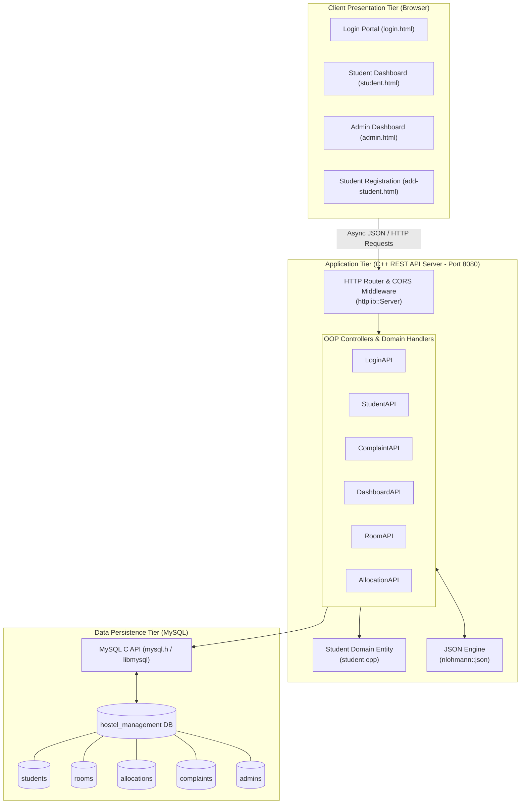
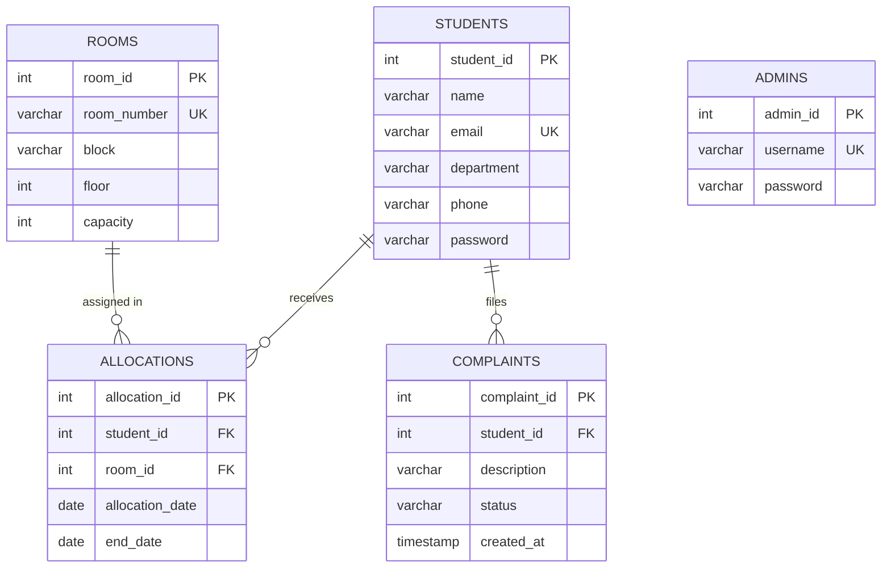

# 🏢 HostelOS — Modern Hostel Management System

[](https://isocpp.org/)
[](https://www.mysql.com/)
[](#-system-architecture)
[](#-tech-stack)
[](#-object-oriented-design--oop-principles)

> A full-stack, object-oriented **Hostel Management System** featuring a high-performance **C++ REST API backend**, a relational **MySQL** database, and a responsive **web presentation portal** for students and hostel administrators.

---

## 📌 Table of Contents

- [Overview](#-overview)
- [Key Features](#-key-features)
  - [Student Portal](#-student-portal)
  - [Admin / Warden Dashboard](#-admin--warden-dashboard)
- [System Architecture](#-system-architecture)
- [Object-Oriented Design & OOP Principles](#-object-oriented-design--oop-principles)
- [Tech Stack](#-tech-stack)
- [Database Schema & ER Design](#-database-schema--er-design)
- [Project Directory Structure](#-project-directory-structure)
- [REST API Reference](#-rest-api-reference)
- [Prerequisites & Requirements](#-prerequisites--requirements)
- [Installation & Quick Start](#-installation--quick-start)
  - [1. Database Setup](#1-database-setup)
  - [2. Environment Variables](#2-environment-variables)
  - [3. Compiling the C++ Backend](#3-compiling-the-c-backend)
  - [4. Running the Backend Server](#4-running-the-backend-server)
  - [5. Launching the Web Frontend](#5-launching-the-web-frontend)
- [Default Demo Credentials](#-default-demo-credentials)
- [Security & Engineering Practices](#-security--engineering-practices)
- [Authors & Acknowledgments](#-authors--acknowledgments)

---

## 📖 Overview

**HostelOS** is an end-to-end management solution designed to replace manual paperwork and spreadsheets in university and college hostels. Built as an Object-Oriented Programming (OOPS) project, it delivers a secure, multi-tier architecture:

- **Frontend Tier:** Modern, reactive web interface using custom design tokens, dark/light themes, and real-time asynchronous API integration via standard `fetch`.
- **Application Backend Tier:** Embedded, multi-threaded C++ REST server powered by `cpp-httplib` and `nlohmann/json`, enforcing strict OOP encapsulation for each domain entity.
- **Persistence Tier:** Structured MySQL database managing relational models for students, room allocations, real-time occupancy counts, and maintenance grievances.

---

## ✨ Key Features

### 🎓 Student Portal
- **Secure Authentication:** Login via numeric Student ID or registered university email.
- **Personalized Profile:** Live view of department, contact details, assigned room number, block, and floor.
- **Grievance Lodging:** Submit maintenance issues and room complaints with categorized descriptions.
- **Ticket Tracking:** Real-time visibility into complaint resolution statuses (`Pending`, `In Progress`, `Resolved`).

### 🛡️ Admin / Warden Dashboard
- **Live Metrics & Analytics:** Real-time KPI cards for Total Students, Total Rooms, Occupancy Rates, Available Vacancies, and Active/Pending Complaints.
- **Room Allocation Management:**
  - Allocate eligible students to rooms with capacity validation.
  - Deallocate rooms on checkout or academic year completion.
  - Live occupancy and vacancy tracking per block and floor.
- **Grievance Triage & Resolution:**
  - View all complaints logged across hostel blocks.
  - Update ticket progression dynamically (`Pending` ➔ `In Progress` ➔ `Resolved`).
- **Student Directory & Onboarding:**
  - Searchable student roster.
  - Integrated registration workflow with automated next-available Student ID suggestion.

---

## 🏛️ System Architecture



---

## 🧩 Object-Oriented Design & OOP Principles

This system exemplifies core Object-Oriented Programming principles:

| Principle | Implementation in Code |
| :--- | :--- |
| **Encapsulation** | API controllers (`LoginAPI`, `StudentAPI`, `ComplaintAPI`, `RoomAPI`, `AllocationAPI`, `DashboardAPI`) protect internal database pointers and query mechanics behind clean public handler interfaces (`handleLogin`, `handleGetStudentById`, etc.). |
| **Domain Modeling** | The `Student` class (`Backend/student.cpp`) encapsulates student data attributes alongside member methods and static persistence operations (`createStudent`, `addStudent`, `viewStudent`). |
| **Separation of Concerns** | Routing, serialization (`nlohmann::json`), input sanitization (`mysql_real_escape_string`), and business logic are divided into dedicated classes rather than monolithic procedures. |
| **Stateless REST Handlers** | API classes consume standard request/response abstractions, enabling clean modular expansion for new endpoints. |

> 📖 **Full UML Class Diagram:** For a complete visual class breakdown and specifications, see [class_diagram.md](class_diagram.md).

---

## 🛠️ Tech Stack

### Backend
- **Language:** C++17 (compiled with GCC / MinGW or MSVC)
- **HTTP Web Server:** [cpp-httplib](https://github.com/yhirose/cpp-httplib) (header-only C++ HTTP/HTTPS server)
- **JSON Processing:** [nlohmann/json](https://github.com/nlohmann/json) (Modern JSON for C++)
- **Database Connector:** MySQL C Client API (`mysql.h`, `libmysql`)

### Frontend
- **HTML5:** Semantic, accessible markup.
- **CSS3:** Custom design system (`tokens.css`, `style.css`, `student.css`) featuring modern typography, glassmorphism, responsive flex/grid layouts, and dark UI palettes.
- **JavaScript:** Native asynchronous workflows (`fetch`, `async/await`, dynamic DOM manipulation) with zero third-party framework overhead.

### Database
- **Engine:** MySQL Server 8.0+ / MariaDB.
- **Storage Engine:** InnoDB with foreign key relational integrity and indexing.

---

## 🗄️ Database Schema & ER Design

The database schema (`Database/database_schema.sql`) consists of five normalized tables:



---

## 📂 Project Directory Structure

```text
Hostel-Management-System/
├── Backend/
│   ├── httplib.h              # Single-header C++ HTTP server library
│   ├── json.hpp               # Single-header nlohmann/json parser
│   ├── student.cpp            # Student entity class and OOP database logic
│   └── main.cpp               # Server entry point, OOP API classes & routes
├── Database/
│   ├── database_schema.sql    # DDL schema (tables, primary/foreign keys)
│   └── sample_data.sql        # Seed script with admins, students, rooms, complaints
├── Frontend/
│   ├── index.html             # Entry redirector to login
│   ├── login.html             # Dual-role authentication UI (Student / Admin)
│   ├── student.html           # Student dashboard & grievance submission
│   ├── admin.html             # Admin overview, room allocations & complaint triage
│   ├── add-student.html       # Student registration & onboarding portal
│   ├── tokens.css             # Color palette, spacing, typography tokens
│   ├── style.css              # Main application styling
│   └── student.css            # Student-specific component styling
├── architecture_diagram.md    # Multi-tier system architecture diagram
├── class_diagram.md           # Object-Oriented UML Class Diagram
├── control_diagram.md         # Runtime Control Flow & Decision Logic Diagram
├── dataflow_diagram.md        # Multi-tiered Data Flow Diagram (DFD L0, L1, L2)
└── README.md                  # Comprehensive project documentation
```

---

## 📡 REST API Reference

The backend operates on `http://localhost:8080` and exposes the following RESTful routes:

| Method | Endpoint | Description | Payload / Parameters |
| :--- | :--- | :--- | :--- |
| `POST` | `/api/login` | Authenticate student or administrator | `{"userId": "...", "password": "..."}` |
| `GET` | `/api/students/:id` | Fetch profile details for a specific student | URL Parameter `:id` |
| `GET` | `/api/admin/students` | Retrieve all registered students | None |
| `GET` | `/api/students/next-id` | Compute next auto-incremented student ID | None |
| `POST` | `/api/students` | Register a new student | `{"name":"...","email":"...","department":"...","phone":"...","password":"..."}` |
| `GET` | `/api/rooms` | List all rooms, current occupancy, and status | None |
| `GET` | `/api/allocations` | List active and past room allocations | None |
| `POST` | `/api/allocations` | Allocate a student to a room | `{"student_id": 101, "room_id": 1}` |
| `PUT` | `/api/allocations/:id/deallocate` | Terminate an active allocation (checkout) | URL Parameter `:id` |
| `GET` | `/api/complaints` | Fetch all complaints (Admin view) | None |
| `GET` | `/api/complaints/:studentId` | Fetch complaints lodged by a student | URL Parameter `:studentId` |
| `POST` | `/api/complaints` | Submit a new grievance ticket | `{"student_id": 101, "description": "..."}` |
| `PUT` | `/api/complaints/:id` | Update grievance status (`Pending`, `In Progress`, `Resolved`) | `{"status": "Resolved"}` |
| `GET` | `/api/admin/dashboard` | Aggregate dashboard KPI metrics | None |

---

## ⚙️ Prerequisites & Requirements

Before building and running the project, ensure you have:

1. **C++ Compiler:**
   - **GCC / MinGW-w64** (v9.0+ supporting C++17) or **MSVC** (Visual Studio 2019+).
2. **MySQL Server:**
   - MySQL 8.0+ or MariaDB 10.4+ running locally or remotely on port `3306`.
   - MySQL C Connector / Development Libraries (`libmysql.dll` / `libmysql.lib` on Windows or `libmysqlclient-dev` on Linux).
3. **Web Browser:**
   - Any modern browser (Google Chrome, Microsoft Edge, Firefox, Brave).
4. **Static HTTP Server (Optional but recommended):**
   - VS Code *Live Server* extension, Python `http.server`, or Node `http-server`.

---

## 🚀 Installation & Quick Start

### 1. Database Setup
Log in to your MySQL terminal or GUI (MySQL Workbench, phpMyAdmin, DBeaver) and run:

```sql
-- Step 1: Create schema and tables
SOURCE Database/database_schema.sql;

-- Step 2: Seed initial demonstration data
SOURCE Database/sample_data.sql;
```

### 2. Environment Variables
The C++ backend securely reads database credentials from environment variables. Set them in your shell before launching the server:

#### Windows (PowerShell)
```powershell
$env:HOSTEL_DB_HOST="localhost"
$env:HOSTEL_DB_USER="root"
$env:HOSTEL_DB_PASSWORD="your_mysql_password"
$env:HOSTEL_DB_NAME="hostel_management"
```

#### Windows (Command Prompt)
```cmd
set HOSTEL_DB_HOST=localhost
set HOSTEL_DB_USER=root
set HOSTEL_DB_PASSWORD=your_mysql_password
set HOSTEL_DB_NAME=hostel_management
```

#### Linux / macOS (Bash)
```bash
export HOSTEL_DB_HOST="localhost"
export HOSTEL_DB_USER="root"
export HOSTEL_DB_PASSWORD="your_mysql_password"
export HOSTEL_DB_NAME="hostel_management"
```

---

### 3. Compiling the C++ Backend

Navigate to the `Backend` directory:
```bash
cd Backend
```

#### Using MinGW-w64 (GCC on Windows)
> Replace `C:/Program Files/MySQL/MySQL Server 8.0` with your actual MySQL installation path.

```bash
g++ -std=c++17 -O2 main.cpp -o server.exe \
    -I"C:/Program Files/MySQL/MySQL Server 8.0/include" \
    -L"C:/Program Files/MySQL/MySQL Server 8.0/lib" \
    -lmysql -lws2_32 -lcrypt32
```

#### Using MSVC (`cl` on Windows Developer Command Prompt)
```cmd
cl /EHsc /std:c++17 main.cpp /I"C:\Program Files\MySQL\MySQL Server 8.0\include" ^
   /link /LIBPATH:"C:\Program Files\MySQL\MySQL Server 8.0\lib" ^
   libmysql.lib ws2_32.lib crypt32.lib /out:server.exe
```

#### Using GCC on Linux
```bash
g++ -std=c++17 -O2 main.cpp -o server -lmysqlclient -lpthread
```

> **Note for Windows:** Ensure `libmysql.dll` (found in your MySQL `lib/` directory) is present in the same directory as `server.exe` or available in your system `PATH`.

---

### 4. Running the Backend Server

Execute the compiled binary:

```bash
# On Windows
.\server.exe

# On Linux
./server
```

You should see:
```text
Server started on port 8080...
```

---

### 5. Launching the Web Frontend

Serve the `Frontend/` folder using any static server or open `Frontend/login.html` directly in your browser:

#### Option A: Python Built-in Server
```bash
cd Frontend
python -m http.server 3000
```
Open [http://localhost:3000](http://localhost:3000) in your browser.

#### Option B: VS Code Live Server
Right-click `Frontend/index.html` or `Frontend/login.html` and select **"Open with Live Server"**.

---

## 🔑 Default Demo Credentials

The seeded database (`sample_data.sql`) contains pre-configured accounts:

### Administrator Accounts
| Username | Password | Role |
| :--- | :--- | :--- |
| `admin` | `admin123` | System Administrator |
| `warden_blockA` | `warden123` | Block A Warden |
| `chief_warden` | `hostel2026` | Chief Warden |

### Sample Student Accounts
| Student ID | Email | Password | Department |
| :--- | :--- | :--- | :--- |
| `101` | `karthik.student@example.com` | `student123` | Computer Science |
| `102` | `priya.sharma@example.com` | `student123` | Electronics & Comm |
| `103` | `aarav.patel@example.com` | `student123` | Mechanical Engineering |
| `104` | `ananya.iyer@example.com` | `student123` | Information Technology |

*(Students can log in with either their numerical **Student ID** or their registered **Email**).*

---

## 🔒 Security & Engineering Practices

- **SQL Injection Prevention:** All dynamic query parameters (usernames, passwords, student details) are passed through `mysql_real_escape_string` before query execution.
- **Environment Decoupling:** Database credentials are never hardcoded; they are ingested via environment variables.
- **CORS Support:** Integrated Cross-Origin Resource Sharing headers enable seamless client-server separation.
- **Relational Integrity:** Foreign keys link allocations and complaints directly to primary student and room records, with cascade and validation safeguards.

---

## 👥 Authors & Acknowledgments

Developed as an **Object-Oriented Programming (OOPS) Mini Project**.

- **Kesava Ashutosh** ([@ashutoshkesava](mailto:ashutoshkesava@gmail.com)) — Core Backend Logic, REST API Architecture & Database Integrations.
- **Hyperionn** ([@itshyperion6907](mailto:itshyperion6907@gmail.com)) — Frontend System Architecture, Design System Tokens & UI/UX Experience.

---

<div align="center">
  <sub>Built with ❤️ using C++, MySQL, and Modern Web Standards.</sub>
</div>
