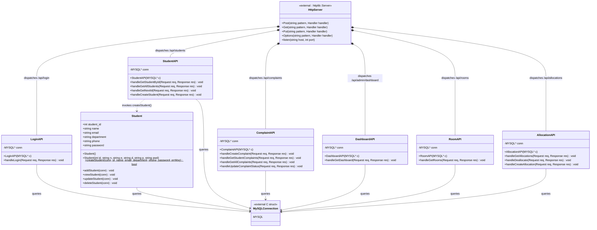

# 📐 HostelOS — UML Class Diagram

This document provides the complete Object-Oriented UML Class Diagram and specifications extracted directly from `Backend/student.cpp` and `Backend/main.cpp`.

---

## 📊 Mermaid Class Diagram

---

## 📋 Class Specifications & Responsibilities

### 1. `Student` (Domain Entity — `Backend/student.cpp`)
Encapsulates individual student entity data and database persistence routines.

- **Attributes:**
  - `+int student_id`: Unique identifier for the student.
  - `+string name`: Full legal name.
  - `+string email`: University email address (unique).
  - `+string department`: Academic department/major.
  - `+string phone`: Contact phone number.
  - `+string password`: Authentication secret (defaults to `"student123"`).
- **Constructors:**
  - `+Student()`: Default parameterless constructor.
  - `+Student(int id, string n, string e, string d, string p, string pwd)`: Parameterized initialization.
- **Methods:**
  - `+createStudent(...) : bool`: Static persistence helper using SQL injection escaping (`mysql_real_escape_string`) to insert student records.
  - `+addStudent(MYSQL* conn) : void`: CLI helper to insert student via standard I/O.
  - `+viewStudent(MYSQL* conn) : void`: CLI helper to print all students.
  - `+updateStudent(MYSQL* conn) : void`: CLI helper to update student fields.
  - `+deleteStudent(MYSQL* conn) : void`: CLI helper to delete a student by ID.

---

### 2. `LoginAPI` (Controller — `Backend/main.cpp`)
Handles unified credential authentication for both Administrator accounts and Student accounts.

- **Attributes:**
  - `-MYSQL* conn`: Database connection handle.
- **Methods:**
  - `+LoginAPI(MYSQL* c)`: Constructor injecting database connection.
  - `+handleLogin(const httplib::Request& req, httplib::Response& res) : void`:
    - Sanitizes input credentials.
    - Checks `admins` table first (`username` + `password`).
    - Falls back to `students` table (`student_id` or `email` + `password`).
    - Returns JSON payload with user role and authentication token metadata.

---

### 3. `StudentAPI` (Controller — `Backend/main.cpp`)
Manages student profiles, rosters, and registration workflows.

- **Attributes:**
  - `-MYSQL* conn`: Database connection handle.
- **Methods:**
  - `+StudentAPI(MYSQL* c)`: Constructor.
  - `+handleGetStudentById(...) : void`: Returns detailed profile JSON for `:id`.
  - `+handleGetAllStudents(...) : void`: Returns full student roster for admin management.
  - `+handleGetNextId(...) : void`: Calculates `COALESCE(MAX(student_id), 100) + 1` for automated ID assignment.
  - `+handleCreateStudent(...) : void`: Validates input, verifies uniqueness of ID and email, and delegates insertion to `Student::createStudent()`.

---

### 4. `ComplaintAPI` (Controller — `Backend/main.cpp`)
Manages student grievance reporting, triage, and lifecycle resolution.

- **Attributes:**
  - `-MYSQL* conn`: Database connection handle.
- **Methods:**
  - `+ComplaintAPI(MYSQL* c)`: Constructor.
  - `+handleCreateComplaint(...) : void`: Creates a new grievance ticket with `Pending` status.
  - `+handleGetStudentComplaints(...) : void`: Retrieves ticket history filed by a specific student.
  - `+handleGetAllComplaints(...) : void`: Retrieves all tickets across hostel blocks for admin review.
  - `+handleUpdateComplaintStatus(...) : void`: Transition status between `Pending`, `In Progress`, and `Resolved`.

---

### 5. `DashboardAPI` (Controller — `Backend/main.cpp`)
Aggregates high-level facility performance metrics for the administrative interface.

- **Attributes:**
  - `-MYSQL* conn`: Database connection handle.
- **Methods:**
  - `+DashboardAPI(MYSQL* c)`: Constructor.
  - `+handleGetDashboard(...) : void`: Runs composite subqueries to compute student count, room count, active allocations, and unresolved complaints in a single atomic payload.

---

### 6. `RoomAPI` (Controller — `Backend/main.cpp`)
Manages room inventory and real-time occupancy calculations.

- **Attributes:**
  - `-MYSQL* conn`: Database connection handle.
- **Methods:**
  - `+RoomAPI(MYSQL* c)`: Constructor.
  - `+handleGetRooms(...) : void`: Executes `LEFT JOIN` between `rooms` and active `allocations` to return room capacity, occupied beds, and remaining availability.

---

### 7. `AllocationAPI` (Controller — `Backend/main.cpp`)
Coordinates assigning and vacating student bed spaces.

- **Attributes:**
  - `-MYSQL* conn`: Database connection handle.
- **Methods:**
  - `+AllocationAPI(MYSQL* c)`: Constructor.
  - `+handleGetAllocations(...) : void`: Returns active and past allocations.
  - `+handleCreateAllocation(...) : void`: Validates date formatting, ensures student exists, prevents double active allocations, verifies room capacity constraints, and persists new allocation.
  - `+handleDeallocate(...) : void`: Sets `end_date = CURDATE()` to check out a student from a room.

---

## 💡 Object-Oriented Principles Applied

1. **Encapsulation:** All internal database handles and SQL execution steps are kept private inside each API class. External consumers only interact via well-defined REST request handlers.
2. **Controller Pattern:** Web endpoints are decoupled from business logic; each controller manages a dedicated bounded context (Login, Student, Complaint, Room, Allocation, Dashboard).
3. **Dependency Injection:** Database connections are instantiated at the server level (`main()`) and injected into each controller via constructors.
4. **Modularity & Reusability:** The `Student` domain model provides reusable static and instance methods, consumed both by CLI routines and the modern REST API server.
