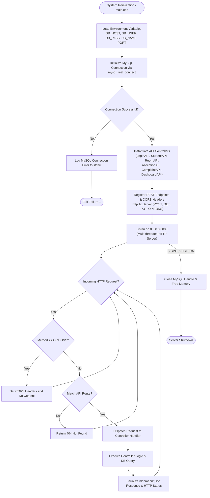
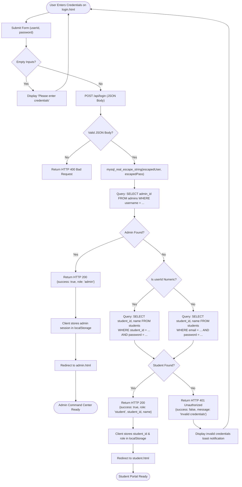
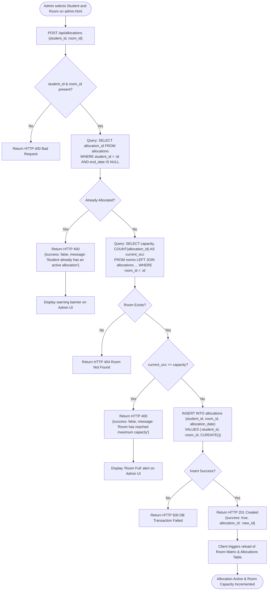
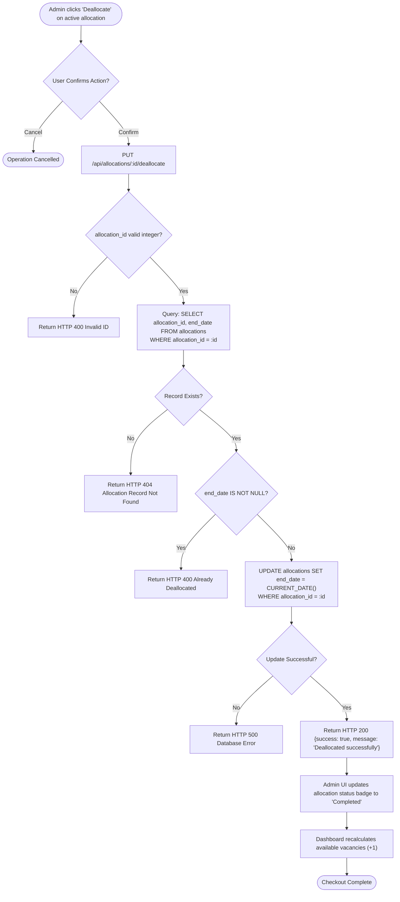
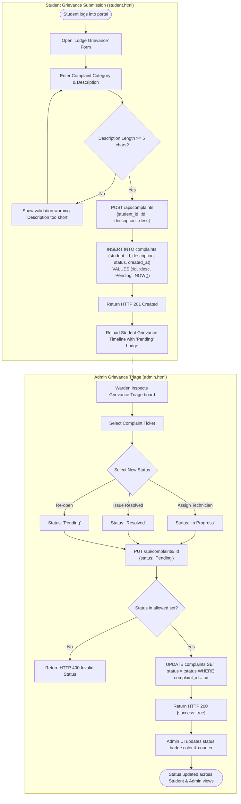
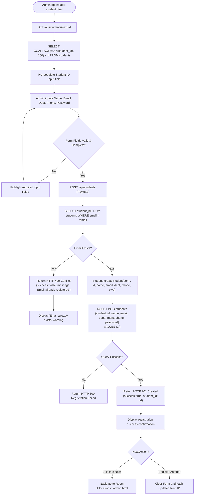

# 🔄 HostelOS — Control Flow Diagrams

This document details the **Control Flow Diagrams (CFD)** for **HostelOS (Hostel Management System)**. It models the operational sequences, decision branches, error conditions, and state transitions across both the Client Presentation Tier and the C++ Application Tier.

---

## 📌 Table of Contents

- [1. Master System Runtime Control Flow](#1-master-system-runtime-control-flow)
- [2. User Authentication & Session Routing Flow](#2-user-authentication--session-routing-flow)
- [3. Room Allocation & Capacity Validation Flow](#3-room-allocation--capacity-validation-flow)
- [4. Resident Checkout & Deallocation Flow](#4-resident-checkout--deallocation-flow)
- [5. Grievance Lodging & Status Triage Flow](#5-grievance-lodging--status-triage-flow)
- [6. Student Onboarding & Registration Flow](#6-student-onboarding--registration-flow)
- [7. Control Flow State & Decision Matrix](#7-control-flow-state--decision-matrix)

---

## 1. Master System Runtime Control Flow

The master control flow captures the server lifecycle from startup and database handshake to HTTP request dispatching and graceful shutdown.

---

## 2. User Authentication & Session Routing Flow

Handles role-based authentication (`POST /api/login`) by verifying credentials sequentially against administrators and students.

---

## 3. Room Allocation & Capacity Validation Flow

Executes the atomic business rules for allocating a resident to a room (`POST /api/allocations`), preventing duplicate allocations and overbooking.

---

## 4. Resident Checkout & Deallocation Flow

Processes resident departure (`PUT /api/allocations/:id/deallocate`) by terminating active residency and freeing hostel vacancy.

---

## 5. Grievance Lodging & Status Triage Flow

Tracks the complaint lifecycle from resident submission on `student.html` through administrative status progression on `admin.html`.

---

## 6. Student Onboarding & Registration Flow

Guides new resident creation (`POST /api/students`), auto-generating identifiers and ensuring contact uniqueness.

---

## 7. Control Flow State & Decision Matrix

| Subsystem / Operation | Trigger Event | Primary Decision | Success Branch | Failure / Exception Branch |
| :--- | :--- | :--- | :--- | :--- |
| **Server Engine** | `main()` execution | MySQL connection handshake | Starts HTTP listening on port 8080 | Emits error code to stderr and terminates process |
| **Login API** | Client submits credentials | Role verification order | 1. Admin matched ➔ `admin.html` 2. Student matched ➔ `student.html` | Return 401 Unauthorized; show error notification |
| **Room Allocation** | Admin assigns student | 1. Duplicate check 2. Room capacity check | Inserts record into `allocations`; increments occupancy | 1. Return 400 (Already allocated) 2. Return 400 (Room capacity full) |
| **Room Deallocation** | Admin terminates residency | Record existence & active status | Sets `end_date = CURDATE()`; room vacancy increments | Return 400 / 404 (Invalid ID or already checked out) |
| **Grievance Lodging** | Student submits ticket | Field length & authentication | Ticket inserted with status `'Pending'` | Return 400 (Missing parameters or invalid student) |
| **Grievance Triage** | Warden changes status | Target status validity | Record updated; UI timeline refreshed | Return 400 (Unsupported status enumeration) |
| **Student Registration** | Admin onboards resident | Unique email/phone constraints | Entity persisted; Next ID computed | Return 409 Conflict (Email/Phone collision) |
| **Dashboard Metrics** | Admin loads `admin.html` | Aggregation queries across 5 tables | KPI metrics computed & visualized | Return 500 (SQL query aggregation error) |
