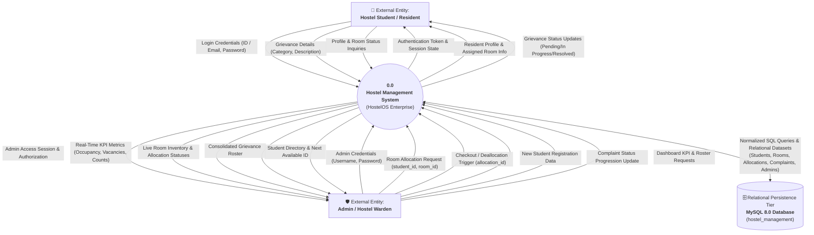
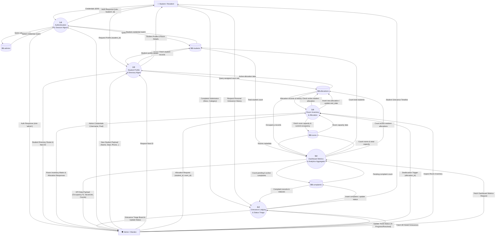
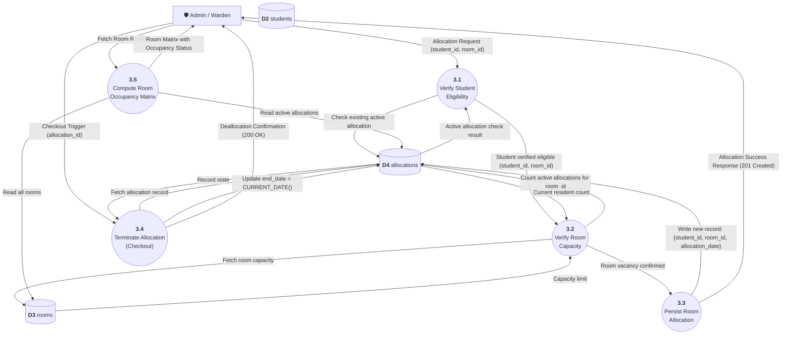
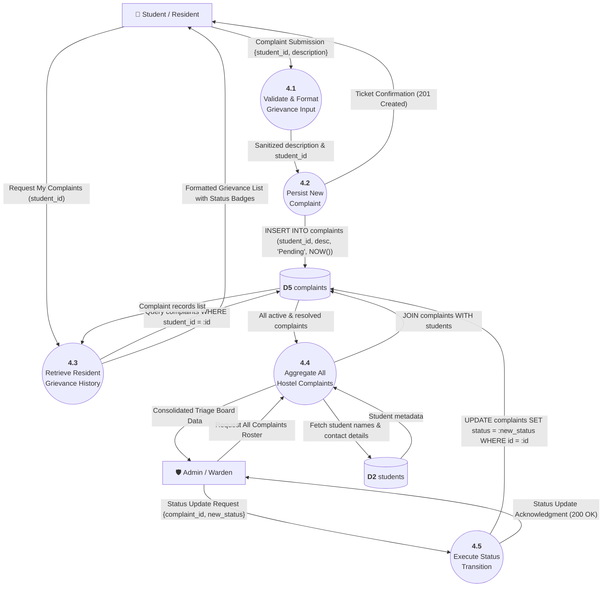
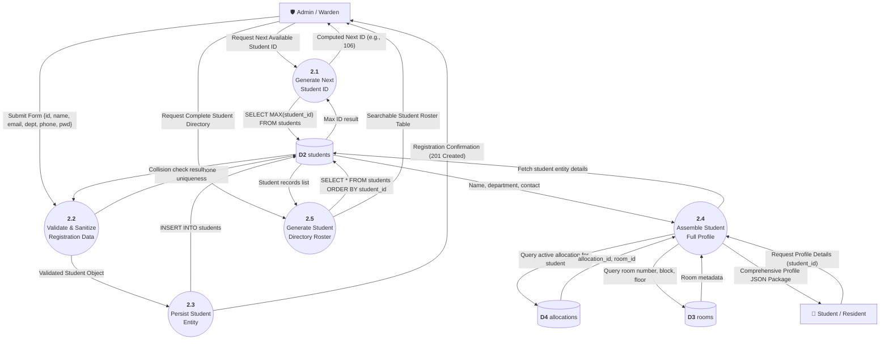

# 📊 HostelOS — Data Flow Diagrams (DFD)

This document provides complete, multi-tiered **Data Flow Diagrams (DFD)** for the **HostelOS (Hostel Management System)** project. It documents the paths data takes through the system, transformation processes, and interactions with external actors and relational data stores.

---

## 📌 Table of Contents

- [1. DFD Architecture & Notation Standards](#1-dfd-architecture--notation-standards)
- [2. Level 0 DFD — Context Diagram](#2-level-0-dfd--context-diagram)
- [3. Level 1 DFD — Subsystem Decomposition](#3-level-1-dfd--subsystem-decomposition)
- [4. Level 2 DFD — Sub-Process Decompositions](#4-level-2-dfd--sub-process-decompositions)
  - [4.1 Sub-Process 3.0: Room Allocation & Deallocation Engine](#41-sub-process-30-room-allocation--deallocation-engine)
  - [4.2 Sub-Process 4.0: Grievance Lodging & Resolution Lifecycle](#42-sub-process-40-grievance-lodging--resolution-lifecycle)
  - [4.3 Sub-Process 2.0: Student Registration & Profile Management](#43-sub-process-20-student-registration--profile-management)
- [5. System Data Dictionary & Data Store Specifications](#5-system-data-dictionary--data-store-specifications)
- [6. REST API Data Payload Mapping](#6-rest-api-data-payload-mapping)

---

## 1. DFD Architecture & Notation Standards

The diagrams follow standard **Gane-Sarson / Yourdon** DFD conventions represented via Mermaid:

| Symbol / Element | Meaning | Representation in HostelOS |
| :--- | :--- | :--- |
| **External Entity** | Source or destination of data outside the system boundary | `Student`, `Administrator / Hostel Warden` |
| **Process** | Activity or operational module transforming data | `1.0 Authentication`, `3.0 Room Allocation`, etc. |
| **Data Store** | Persistent repository where records are stored | `D1: admins`, `D2: students`, `D3: rooms`, `D4: allocations`, `D5: complaints` |
| **Data Flow** | Directed movement of data packets/objects | Arrows with descriptive nouns/data packets |

---

## 2. Level 0 DFD — Context Diagram

The **Context Diagram** establishes the boundary of the HostelOS system, identifying external actors and high-level input/output data flows.

---

## 3. Level 1 DFD — Subsystem Decomposition

The **Level 1 DFD** decomposes HostelOS into five core operational processes, mapping data flows directly to the corresponding database stores.

---

## 4. Level 2 DFD — Sub-Process Decompositions

### 4.1 Sub-Process 3.0: Room Allocation & Deallocation Engine

Deconstructs the room allocation transaction into validation, capacity checking, record persistence, and deallocation sub-processes.

---

### 4.2 Sub-Process 4.0: Grievance Lodging & Resolution Lifecycle

Traces the data transformations from initial grievance logging to triage and resolution.

---

### 4.3 Sub-Process 2.0: Student Registration & Profile Management

Details the data transformations during student onboarding and profile visualization.

---

## 5. System Data Dictionary & Data Store Specifications

The five primary data stores defined in `Database/database_schema.sql` handle the following structured entity flows:

### Data Store D1: `admins`
Stores administrative authentication credentials and access control parameters.
- **Attributes:**
  - `admin_id` (INT, Primary Key, Auto-increment)
  - `username` (VARCHAR(50), Unique, Not Null)
  - `password` (VARCHAR(255), Not Null)
- **Inflows:** Initial database seed (`Database/sample_data.sql`).
- **Outflows:** Credential verification in `Process 1.0 (LoginAPI)`.

### Data Store D2: `students`
Stores resident demographic, academic, and authentication data.
- **Attributes:**
  - `student_id` (INT, Primary Key)
  - `name` (VARCHAR(100), Not Null)
  - `email` (VARCHAR(100), Unique, Not Null)
  - `department` (VARCHAR(50))
  - `phone` (VARCHAR(15))
  - `password` (VARCHAR(255), Not Null)
- **Inflows:** Student onboarding from `Process 2.0 (StudentAPI::handleCreateStudent)`.
- **Outflows:** Authentication in `Process 1.0`, profile queries in `Process 2.0`, KPI metrics in `Process 5.0`.

### Data Store D3: `rooms`
Maintains hostel infrastructure inventory, floor plans, and capacity allocations.
- **Attributes:**
  - `room_id` (INT, Primary Key, Auto-increment)
  - `room_number` (VARCHAR(10), Unique, Not Null)
  - `block` (VARCHAR(10), Not Null)
  - `floor` (INT, Not Null)
  - `capacity` (INT, Not Null, Default 2)
- **Inflows:** Facility configuration scripts.
- **Outflows:** Capacity verification in `Process 3.0 (AllocationAPI)`, room matrix visualization in `Process 3.0 (RoomAPI)`, facility KPI calculations in `Process 5.0 (DashboardAPI)`.

### Data Store D4: `allocations`
Captures historical and active relationships between students and rooms.
- **Attributes:**
  - `allocation_id` (INT, Primary Key, Auto-increment)
  - `student_id` (INT, Foreign Key references `students(student_id)`)
  - `room_id` (INT, Foreign Key references `rooms(room_id)`)
  - `allocation_date` (DATE, Not Null)
  - `end_date` (DATE, Nullable — `NULL` indicates active residency)
- **Inflows:** New room assignment in `Process 3.0 (AllocationAPI::handleCreateAllocation)`.
- **Outflows:** Occupancy validation in `Process 3.0`, active room lookup in `Process 2.0`, checkout updates in `Process 3.0 (AllocationAPI::handleDeallocate)`.

### Data Store D5: `complaints`
Records facility maintenance issues, student grievances, and resolution progress.
- **Attributes:**
  - `complaint_id` (INT, Primary Key, Auto-increment)
  - `student_id` (INT, Foreign Key references `students(student_id)`)
  - `description` (TEXT, Not Null)
  - `status` (VARCHAR(20), Default `'Pending'`; Enum: `'Pending'`, `'In Progress'`, `'Resolved'`)
  - `created_at` (TIMESTAMP, Default `CURRENT_TIMESTAMP`)
- **Inflows:** Grievance submissions from `Process 4.0 (ComplaintAPI::handleCreateComplaint)`.
- **Outflows:** Status triage updates from `Process 4.0 (ComplaintAPI::handleUpdateComplaintStatus)`, grievance timelines in `Process 4.0`, pending complaint counts in `Process 5.0`.

---

## 6. REST API Data Payload Mapping

| Process ID | REST Method & Endpoint | Source / Producer | Inbound Data Payload | Outbound Data Payload | Destination Store |
| :--- | :--- | :--- | :--- | :--- | :--- |
| **1.0** | `POST /api/login` | Client Portal | `{"userId":"101", "password":"..."}` | `{"success":true, "role":"student", "student_id":"101"}` | `D1`, `D2` |
| **2.1** | `GET /api/students/next-id` | Admin Portal | None | `{"success":true, "next_id":106}` | `D2` |
| **2.2** | `POST /api/students` | Admin Portal | `{"name":"...", "email":"...", "department":"...", "phone":"...", "password":"..."}` | `{"success":true, "message":"Created", "student_id":106}` | `D2` |
| **2.4** | `GET /api/students/:id` | Student Portal | URL parameter `:id` | `{"success":true, "student":{..., "room_number":"A-101", "block":"A"}}` | `D2`, `D3`, `D4` |
| **3.2** | `GET /api/rooms` | Admin Portal | None | `{"success":true, "rooms":[{"room_number":"A-101", "capacity":2, "occupancy":1, "status":"Available"}]}` | `D3`, `D4` |
| **3.3** | `POST /api/allocations` | Admin Portal | `{"student_id":101, "room_id":1}` | `{"success":true, "allocation_id":4}` | `D3`, `D4` |
| **3.4** | `PUT /api/allocations/:id/deallocate`| Admin Portal | URL parameter `:id` | `{"success":true, "message":"Deallocated successfully"}` | `D4` |
| **4.2** | `POST /api/complaints` | Student Portal | `{"student_id":101, "description":"Fan not working"}` | `{"success":true, "complaint_id":7}` | `D5` |
| **4.3** | `GET /api/complaints/:studentId` | Student Portal | URL parameter `:studentId` | `{"success":true, "complaints":[{"id":7, "description":"...", "status":"Pending"}]}` | `D5` |
| **4.5** | `PUT /api/complaints/:id` | Admin Portal | `{"status":"In Progress"}` | `{"success":true, "message":"Updated"}` | `D5` |
| **5.0** | `GET /api/admin/dashboard` | Admin Portal | None | `{"success":true, "total_students":5, "total_rooms":6, "occupancy_rate":50.0, "vacancies":6, "pending_complaints":2}` | `D2`, `D3`, `D4`, `D5` |
